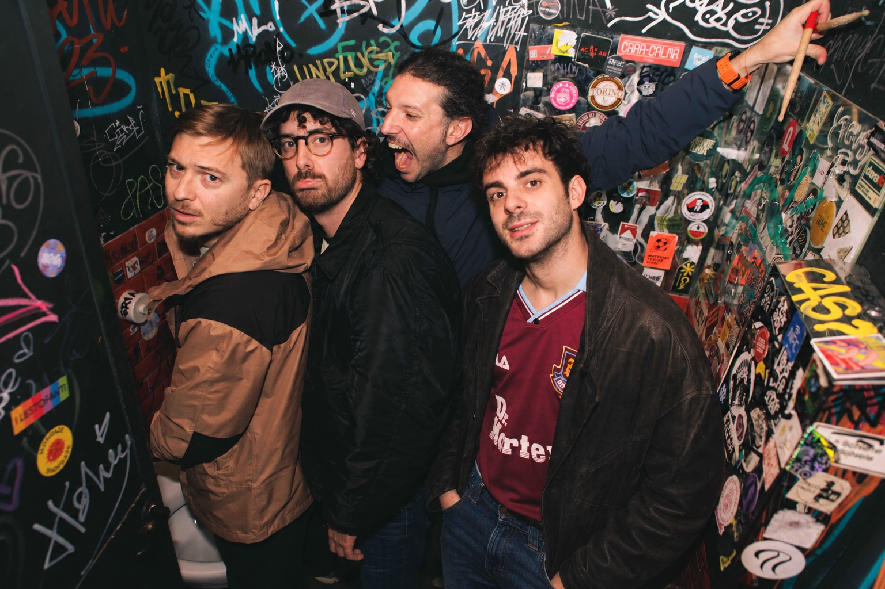
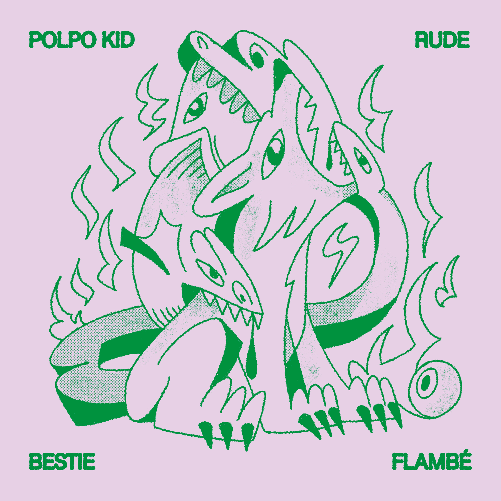
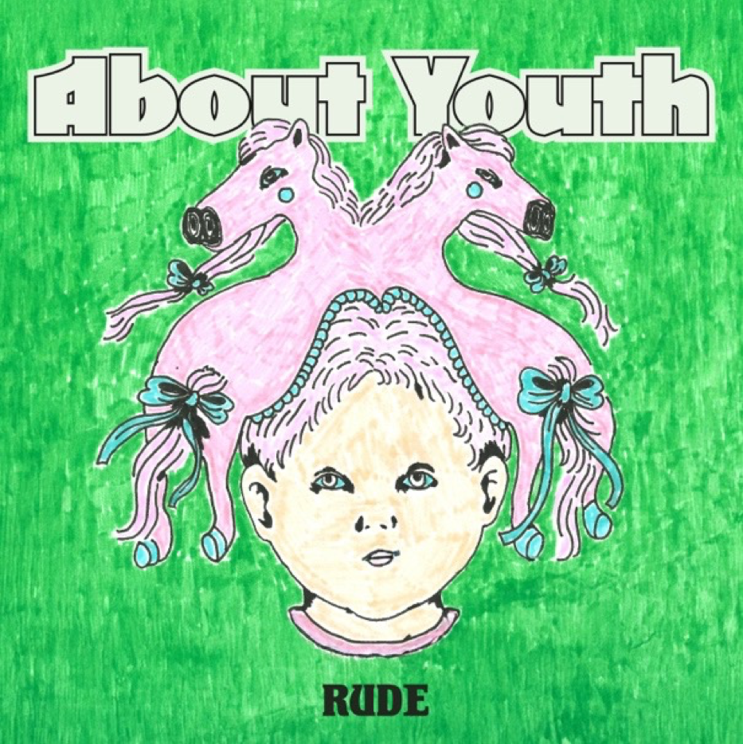
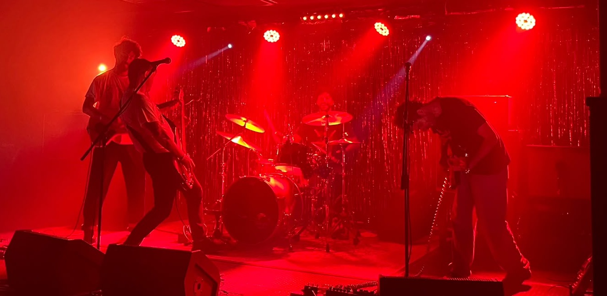
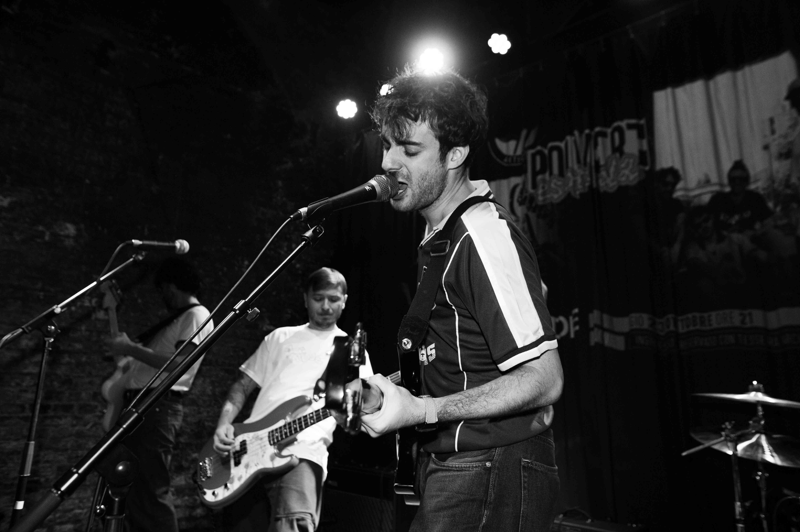
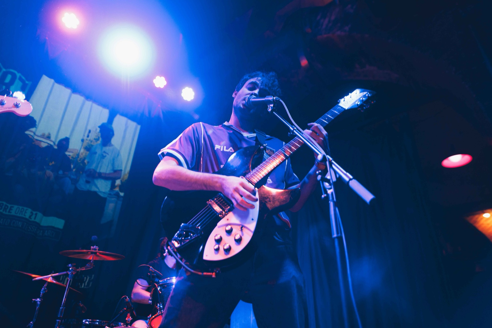

<div align="center">

<br>


<br><br>

```
GARAGE / POST PUNK DA MILANO
```

**[tigredicarta.github.io/about.rude](https://tigredicarta.github.io/about.rude/)**

<br>

<a href="https://tigredicarta.github.io/about.rude/">Sito Ufficiale & EPK ↗</a> &nbsp;·&nbsp;
<a href="RUDE_PressKit_2026.pdf">Press Kit (PDF) ↓</a> &nbsp;·&nbsp;
<a href="RUDE-scheda-tecnica.pdf">Scheda Tecnica & Stage Plot (PDF) ↓</a> &nbsp;·&nbsp;
<a href="https://rude-theband.bandcamp.com">Bandcamp ↗</a>

<br><br>



</div>

<br>

### Manifesto

> Suoni che nascono dall’eco del punk e del post-hardcore di fine anni ’80, ma prendono una forma personale, ruvida e viscerale: chitarre affilate, ritmi sincopati, linee vocali feroci e malinconiche.
>
> Dentro ci stanno rabbia e melodia, disillusione e resistenza; **Fugazi e The Libertines, Paolo Sollier e Kae Tempest.**

---

### Formazione

<table>
  <tr>
    <td width="50%">
      <strong>Lorenzo</strong><br>
      <code>voce principale · chitarra</code>
    </td>
    <td width="50%">
      <strong>Francesco C</strong><br>
      <code>chitarra · cori</code>
    </td>
  </tr>
  <tr>
    <td width="50%">
      <strong>Francesco P</strong><br>
      <code>voce · basso</code>
    </td>
    <td width="50%">
      <strong>Adriano</strong><br>
      <code>batteria</code>
    </td>
  </tr>
</table>

---

### Discografia

<table>
  <thead>
    <tr>
      <th width="50%" align="center"><strong>BESTIE FLAMBÉ</strong> · Split 12″ (2026)</th>
      <th width="50%" align="center"><strong>ABOUT YOUTH</strong> · LP (2025)</th>
    </tr>
  </thead>
  <tbody>
    <tr>
      <td align="center" valign="top">
        <br>
        <a href="https://rude-theband.bandcamp.com/album/bestie-flamb">
          
        </a>
        <br><br>
        <strong>RUDE / Polpo Kid</strong><br>
        <em>Il primo lavoro cantato in italiano</em>
        <br><br>
        <div align="left">
<pre>
LATO A — RUDE
01. Veg Burger
02. Bestie Forever

LATO B — Polpo Kid
03. Soffritto
04. Love Shines
</pre>
          <small>
            Registrato e mixato da Alberto Casagrande (<em>Famaghost</em>, Milano)<br>
            Master di Filippo Passamonti (<em>VDSS Studio</em>)
          </small>
        </div>
        <br>
        <a href="https://rude-theband.bandcamp.com/album/bestie-flamb">Ascolta su Bandcamp ↗</a>
      </td>
      <td align="center" valign="top">
        <br>
        <a href="https://open.spotify.com/album/3KdGtn4bo1ippG8VvX0AIx">
          
        </a>
        <br><br>
        <strong>Album d'esordio</strong><br>
        <em>8 tracce garage / post-punk</em>
        <br><br>
        <div align="left">
<pre>
01. About Youth       05. Distant Echoes
02. City Lights       06. Riot Hearts
03. Cold Rain         07. Concrete Walls
04. Modern Rust       08. No Tomorrow
</pre>
          <small>
            Registrato e mixato da Andrea Maglia (<em>Bleach Studio</em>)<br>
            Master di Matt Bordin (<em>Outside Inside Studio</em>)
          </small>
        </div>
        <br>
        <a href="https://open.spotify.com/album/3KdGtn4bo1ippG8VvX0AIx">Ascolta su Spotify ↗</a>
      </td>
    </tr>
  </tbody>
</table>

---

### Dal Vivo

<table>
  <tr>
    <td width="33.33%" align="center">
      
    </td>
    <td width="33.33%" align="center">
      
    </td>
    <td width="33.33%" align="center">
      
    </td>
  </tr>
</table>

**Una selezione dei locali calpestati:**  
`Magazzino sul Po (Torino)` · `ARCI Gagarin (Busto Arsizio)` · `Detune (Milano)` · `Cinemino Noise (Milano)` · `Labrutepoque (Milano)` · `Gallery16 (Bologna)` · `Ri-Circolo (Morbegno)` · `Barrio’s` · `C.I.Q.` · `Bachelite Clab`

---

### Documentazione Tecnica & Download

Tutti i documenti PDF sono inclusi nel repository e generati direttamente dai sorgenti HTML ad alta risoluzione in formato A4:

<table>
  <tr>
    <td width="50%" valign="top">
      <h4>Press Kit Ufficiale 2026</h4>
      <p>3 pagine A4: Biografia, schede release Bestie Flambé / About Youth, foto promozionali e rassegna live.</p>
      <a href="RUDE_PressKit_2026.pdf"><strong>Download Press Kit (PDF) ↓</strong></a>
    </td>
    <td width="50%" valign="top">
      <h4>Scheda Tecnica & Stage Plot</h4>
      <p>2 pagine A4: Input list 12 canali, backline, 4 mandate monitor indipendenti e disposizione palco.</p>
      <a href="RUDE-scheda-tecnica.pdf"><strong>Download Scheda Tecnica (PDF) ↓</strong></a>
    </td>
  </tr>
</table>

*I template grafici A4 di compilazione sono disponibili nella cartella [`_sources/`](_sources/).*

---

<div align="center">

<br>

### Contatti & Booking

**Lorenzo** · [+39 349 725 4732](tel:+393497254732) · [theband.rude@gmail.com](mailto:theband.rude@gmail.com)

<br>

[Sito Web Live](https://tigredicarta.github.io/about.rude/) &nbsp;·&nbsp;
[Bandcamp](https://rude-theband.bandcamp.com) &nbsp;·&nbsp;
[Instagram @about.rude](https://www.instagram.com/about.rude/) &nbsp;·&nbsp;
[Cartella Foto Stampa HD (Google Drive)](https://drive.google.com/drive/folders/1zqtWuZhpxeb7gdpfX2_qQgWxhYfGLNE7)

<br><br>

```
MILANO UNDERGROUND · DIY SPIRIT · 2026
```

<br>

</div>
